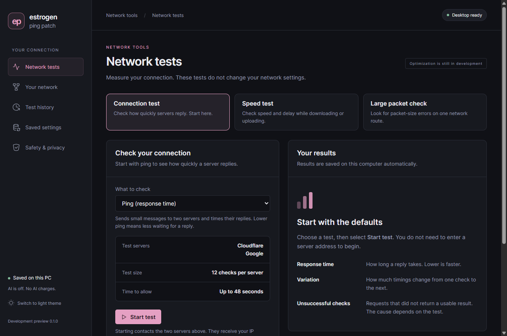
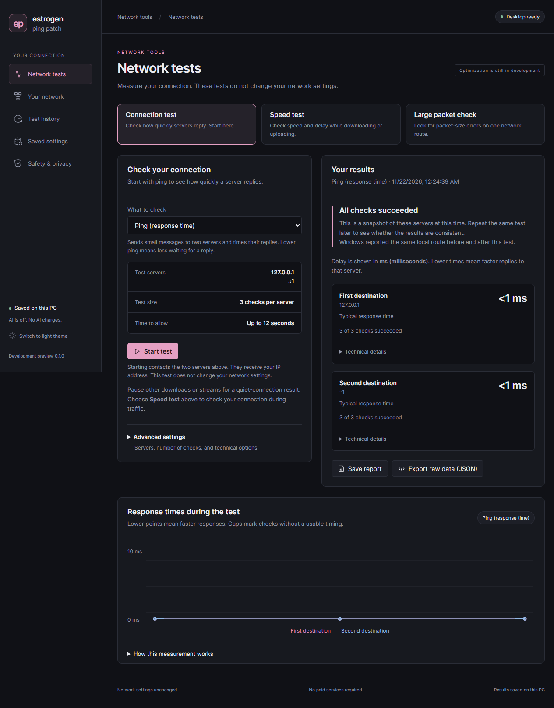
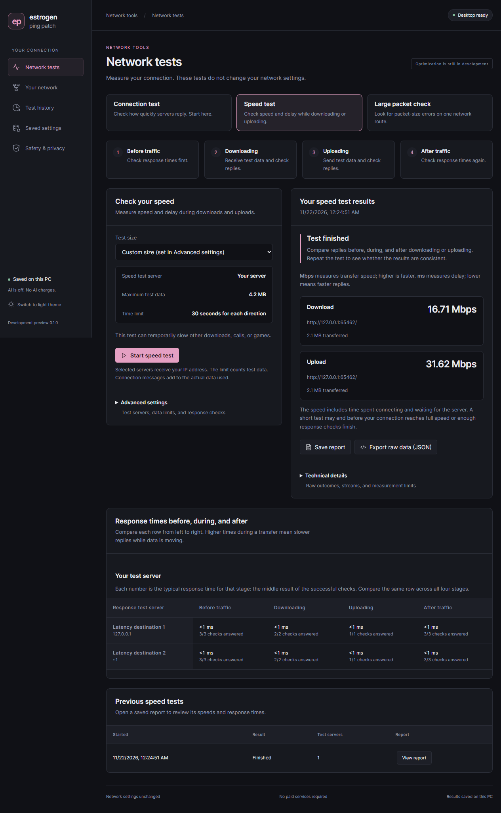

# estrogen ping patch

**A Windows network benchmarking app and an MCP server for AI-assisted network tuning.**

This is an unfinished MIT-licensed project. The desktop app can run network tests today. The Model Context Protocol (MCP) server can tell an AI client which operations the app permits. **Automatic optimization is still disabled.** Forks are welcome to finish and release it.

## What works today

| In the app | What it measures or saves |
| --- | --- |
| **Connection test** | Ping, TCP connection time, and DNS lookup time across selected destinations. |
| **Speed test** | HTTP download and upload speeds and how response time changes while the connection is busy. Uses Cloudflare or a server you control. |
| **Large packet check** | Tests whether a destination can receive larger IPv4 packets. A timeout alone is inconclusive. |
| **History and reports** | Saves results locally and exports HTML or JSON. Network settings snapshots can be exported for inspection. |

The tests measure the Windows connection as a whole. Pick benchmark destinations that represent the routes you care about. The app needs no game selection or in-game telemetry. Results depend on the destinations and current network conditions.

See example benchmark results

These results are from local loopback tests in an isolated app profile.

## Run on Windows

Use Windows 10 or 11 x64 with Rust stable (MSVC), Node.js 24 LTS with npm 11 or 12, Visual Studio 2022 C++ Build Tools with the Windows SDK, and the Microsoft Edge WebView2 Runtime.

1. Clone or fork this repository.
2. Double-click [setup.bat](setup.bat) to check the toolchain and install project dependencies.
3. Double-click [launch.bat](launch.bat) and open **Network tests**.

| Script | Use it to |
| --- | --- |
| [test.bat](test.bat) | Run the automated checks. |
| [build.bat](build.bat) | Build the desktop executable at <code>target/release/estrogen-ping-patch.exe</code>. |
| [package.bat](package.bat) | Build an unsigned installer under <code>target/release/bundle/nsis</code>. The installed app opens from the Start menu. |
| [clean.bat](clean.bat) | Remove generated builds while preserving dependencies and local app data. |

If setup reports missing C++ components, select **Desktop development with C++** and a Windows SDK in Visual Studio Installer. Close the app and launcher before starting another project script. Set <code>EPP_NO_PAUSE=1</code> when running the scripts unattended. The optional Windows service is managed separately from **Safety & privacy**.

### Test with a local server

Run <code>node scripts/benchmark-server.mjs</code>. In **Speed test → Advanced settings**, turn off Cloudflare and enter <code>http://127.0.0.1:8088/</code>. Use loopback latency targets to keep the test local.

For a server you control, the [reference implementation](scripts/benchmark-server.mjs) shows the two endpoints. <code>GET /epp/v1/download?bytes=N</code> returns exactly N uncompressed synthetic bytes. <code>POST /epp/v1/upload</code> consumes the declared body and acknowledges its size in <code>X-Epp-Received-Bytes</code>. Both responses require <code>X-Epp-Benchmark-Protocol: 1</code>. Remote origins require HTTPS with valid certificates.

## Connect an AI client over MCP

Build the desktop executable, then add it to a client that supports local stdio MCP servers. In clients that use an <code>mcpServers</code> JSON object, replace the example path with the absolute path to your executable.

~~~json
{
  "mcpServers": {
    "estrogen-ping-patch": {
      "command": "C:/path/to/estrogen-ping-patch.exe",
      "args": ["--mcp"]
    }
  }
}
~~~

The server currently exposes two read-only tools:

- <code>get_current_constraints</code> returns the app's safety and benchmark defaults.
- <code>get_candidate_catalog</code> reports that no setting change is enabled.

The intended workflow is for an AI client to review benchmark evidence and propose a typed change. The user approves a bounded trial, and the Windows service saves the exact original settings, applies the approved candidate temporarily, and verifies restoration or a separate decision to keep it. The AI client would never receive arbitrary shell, registry, or network-setting access. Today, the MCP server stops at capability discovery. Run benchmarks from the desktop.

## What a fork needs to finish

1. **Connect MCP proposals to the app.** Expose reviewed benchmark evidence and a typed proposal interface. Show the proposed change and its scope in the desktop, then require explicit, revocable approval before the service can act.
2. **Finish and verify recovery before turning on changes.** The repo contains scoped MTU trial and recovery code for a separate Windows lab. Wire the production service to verify a durable backup of the exact original values, adapter GUID, and OS and driver context before applying a candidate. Preserve automatic versus static DNS and addressing. Test offline recovery and exact readback after cancellation, a crash, and a reboot on real adapters.
3. **Prove the optimizer can make a reliable decision.** Complete provider eligibility and traffic budgets, stable-route and workload checks, sustained load testing, and regression guards. Use repeated comparable benchmarks to show a meaningful improvement, and offer **Keep** or **Revert** with an honest inconclusive outcome.
4. **Validate and package the finished release.** Exercise Ethernet, Wi-Fi, IPv4 and IPv6, supported Windows versions, upgrades, and least-privilege service accounts. Finish optional AI provider controls, scheduling, and progress estimates as needed. Sign the installer for distribution.

Start with [the MCP server](crates/core/src/mcp.rs), [the Tauri command layer](src-tauri/src/main.rs), [the experiment code](crates/service/src/experiment), and [the Windows service](crates/service). The packaged service is read-only. Exported diagnostic snapshots are not automatic restore points.

## Data and license

The app keeps history and snapshots in <code>%LOCALAPPDATA%\estrogen-ping-patch</code>. Starting a benchmark sends test traffic to the selected destinations. Exports can contain IP addresses and adapter details, so review them before sharing.

MIT licensed. See [LICENSE](LICENSE). The desktop bundles [Iconoir](https://iconoir.com/) icons under their [MIT notice](assets/iconoir-license.txt).
